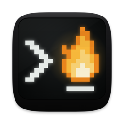

<p align="center"></p>

# Libertty

English | [简体中文](README.zh-CN.md)

A terminal for macOS. [libghostty-vt](https://github.com/ghostty-org/ghostty) parses
the VT stream and keeps terminal state; the app is Swift and AppKit with its own Metal
renderer. Shells run in a separate daemon, `liberttyd`, so they keep running when the
app quits. A window can also hold documents and tools: an editor, a Git client, a
browser and more.

## Install

```sh
brew install --cask ziwangprincex/libertty/libertty
```

Or download the DMG from the [latest release](https://github.com/ziwangprincex/Libertty/releases/latest)
and drag Libertty to Applications. macOS blocks the first launch because the app isn't
notarized: open it once, then System Settings ▸ Privacy & Security ▸ Open Anyway (or run
`xattr -dr com.apple.quarantine /Applications/Libertty.app`).

Libertty updates itself. The `libertty` command is on `PATH` in its shells; Homebrew also
links it. The Git features need a `git` (Command Line Tools or Homebrew); everything else
works without one.

Programs in Libertty's sessions ask for privacy permissions (camera, files, Full Disk
Access) as "Libertty Sessions". For Full Disk Access, add
`/Applications/Libertty.app/Contents/MacOS/liberttyd` in System Settings. Libertty is
signed with a certificate of its own, so what you grant stays granted across updates.

## Features

**Terminal.** Metal rendering; box drawing, Powerline and braille drawn from the grid;
kitty graphics; ligatures. `TERM=xterm-ghostty` with its terminfo (`ssh` sends
`xterm-256color`, or `xterm-ghostty` to hosts set up with `libertty +terminfo setup`).
Shell integration for zsh, bash and fish. OSC 8 links, OSC 9/777 notifications, OSC 9;4
progress, OSC 52 clipboard (reading off by default), OSC 7501 program status. ⌘-click opens
URLs and `file:line:col`; ⌘Y shows the files and pages on screen in Quick Look. Fallback
fonts (`font-family` repeats, as in Ghostty), `font-thicken`, and an optional cursor trail
(`cursor-trail`). Secure Keyboard Entry turns itself on while a password is read.

**At the prompt.** Ghost text from your history (this folder's first; → takes it) and a
completion list (⌃⇧Space) of history, commands' subcommands and flags, branches, scripts,
hosts and paths, read off the screen so it works on hosts too. A click on the command line
moves the cursor there. Copy mode (⌘⇧C) moves through the scrollback with vi keys; hint
mode (⌘⇧H) labels every link, path and hash on screen to open or copy. Programs can draw
native cards and panels in their output ([OSC 7502](docs/surface-protocol.md),
`libertty +surface`), and after `git status`, a build's errors or a search, a chip opens
them as a list.

**Window.** Laid out after Rex: tabs in a sidebar on the left or right, or along the top
(`tab-bar`); panes as cards, each with a header (split, float, zoom, close);
`pane-style = compact` for edge-to-edge panes; `interface-style = glass` for a translucent
window. Splits, workspaces, parked and floating panes, moving panes and tabs between
windows, command palette (⌘⇧P), Quick Terminal, undo for closing a pane, tab or window.
Floating panes (⌥⇧⌘F) are shells of their own over the split, minimized with ⌥⌘F. Key
sequences (`keybind = ctrl+b>v=new_split:right`) show which keys can follow.
On a trackpad, spread two fingers to zoom a pane and pinch to restore it; Option-swipe
sideways shows or hides the sidebar. `active-border` draws a border round the focused pane.

**Program status.** Tabs show whether a program is working, waiting for you, done or
failed (OSC 7501, or a password prompt). Each state can show on tabs, notify, count in the
Dock badge or play a sound. The Activity popup lists every pane by state.

**Sessions.** Quitting, a crash or an update leaves programs running in liberttyd; the
next launch restores windows, splits, screens and scrollback. A newer liberttyd takes over
without ending sessions. With `auto-update-restart = idle`, a downloaded update installs
itself while you're away. Settings ▸ liberttyd ▸ System Permissions shows what macOS lets
your programs reach (Full Disk Access, screen recording, camera, microphone).

**Remote hosts.** File ▸ Connect to Host… (`libertty +connect HOST`) runs a window's panes
on another machine over your `ssh`. The host gets its own liberttyd in `~/.libertty` (no
root), so programs survive disconnects. Screenshots and files pasted or dropped on a host's
pane are sent there first, so a program there gets a path it can open. Settings ▸ Remote
Hosts lists your hosts and how each is, and helps when ssh can't connect (a changed host
key, keys not in ssh-agent). Hosts: macOS (Apple silicon), Linux (x86_64, aarch64).

**Web access.** `web-access = local | network | tailscale` shows the Mac's panes in a
browser, behind a secret link. `web-access-input = false` makes it read-only.

**Documents and tools**, in a tab or beside a terminal:

| | |
|---|---|
| Documents | Markdown (with Mermaid diagrams), highlighted source, images, PDF, web pages, `git diff` |
| Editor | CodeMirror 6, Vim keys, usable as `$EDITOR` (`libertty +open --wait`) |
| Git | Stage by file or hunk, commit, history graph, branches, push and pull, stashes, conflicts |
| Browser | Search, downloads; `libertty +browser` for agents only with `browser-automation = true` |
| Tasks | Processes by terminal, CPU, memory, ports |
| Canvas, Board | Excalidraw drawings; a Kanban board stored as Markdown |
| SQLite, Notebook | Browse and query a database; run `.ipynb` cells in your own Jupyter |
| Profiler, Screen | `sample` shown in speedscope; a display or window via ScreenCaptureKit |
| Plugins | JavaScript in `~/.config/libertty/plugins/`, off until enabled |

**Coding agents.** `libertty +agent-setup` adds hooks for Claude Code and Codex (and an
extension for Pi, OMP and OpenCode), so their tabs show working, waiting or done, sessions are
named after their task, and their conversations resume after a restart (File ▸ Resume
Conversation…, ⇧⌘O). Other agents' states are read from their screens, by liberttyd itself,
so `libertty +events --for waiting` hears them with no window open; your own agents' rules go
in `~/.config/libertty/agents/`. The composer (⌘⇧E) writes a prompt of several lines; the
prompt queue (⌘⇧M) sends prompts one at a time as the agent comes to rest; Fork Conversation
carries a Claude Code or Codex conversation on in a new pane. ⌘J jumps to the pane
that needs you; the Git block's Last Turn shows what an agent changed in its latest turn, to
revert or keep hunk by hunk; File ▸ New Tab in Worktree… (⌥⌘T) gives an agent a branch and a
folder of its own. Sidebar rows and pane headers show each pane's branch and changes. A
screenshot pasted into a pane pastes as its file's path. `keep-awake = agents` keeps the Mac
awake while they work. `--remove` takes the hooks out. Tabs show each agent's own logo
(30 of them: Claude Code, Codex, Gemini, CodeBuddy, Qwen Code, Kimi, Copilot, Cursor, Aider…),
and closing a pane where one is working or waiting says so by name.

**Getting started.** A short guide on first launch (Help ▸ Get Started with Libertty):
the look, permissions, agent setup, Ghostty's settings, a few keys. `libertty +migrate-prompt`
(or Help ▸ Migrate Keybindings with an Agent…) gives an agent a prompt to bring over your
Ghostty, iTerm2 or tmux keybindings.

**Scripting.** The `libertty` command (completion for zsh, bash and fish), AppleScript
(windows, tabs, sessions; new tab, split, input, run command, perform action), and
`remote-control = false` to keep agents from driving the app.

**Language.** English, or Simplified Chinese when macOS uses it (`language = auto | en | zh-Hans`).

## Configuration

`~/.config/libertty/config`, in Ghostty's format. Libertty ▸ Settings… (⌘,) edits it
(one line per change); the file can also be edited by hand and applies on save. Themes:
Ghostty theme files, an installed Ghostty's or Rex's themes by name
(`theme = light:Merino Light,dark:Merino Dark`), or your own from Libertty ▸ Theme Editor….

```sh
libertty +set theme="Tokyo Night" font-size=14
libertty +show-config --changes      # --default, --docs
libertty +validate-config
libertty +import-ghostty --dry-run
libertty +list-themes                # +list-fonts, +list-keybinds, +list-actions
```

## Command line

`libertty +help` lists every command. Some:

```sh
libertty +new-window --cwd ~/src -e htop
libertty +open [--split] [--wait] FILE[:LINE]
libertty +list-sessions
libertty +send ID 'make test\n' ; libertty +send-key ID ctrl+c
libertty +capture ID [--scrollback] [--ansi | --html]
libertty +wait ID --until exit|prompt|idle=MS
libertty +split [ID] [--down] [-e COMMAND]
libertty +prompt ID 'review src/auth'      # ask another agent; prints its answer
libertty +events --for waiting --once      # until a program waits for you
libertty +new-session --worktree fix-login -e claude
libertty +history ; libertty +resume ID   # agents' past conversations
libertty +diff --turn                      # what an agent changed in its last turn
libertty +migrate-prompt --from tmux       # a prompt that has an agent move your keybindings over
```

Session commands take `--host HOST`. `$LIBERTTY_SESSION` is the current pane's session.

## Build

Needs Swift 6 (the Command Line Tools are enough) and Zig 0.17 (`brew install zig`).
Node.js only to rebuild the bundled web pages, which are already built in the repository.

```sh
git submodule update --init vendor/ghostty
scripts/build-libghostty-vt.sh       # once, and after updating vendor/ghostty
scripts/bundle.sh                    # build/Libertty.app; `release` for an optimized build
open build/Libertty.app
```

A build run by hand reaches your own liberttyd unless told otherwise; see
[docs/DEVELOPMENT.md](docs/DEVELOPMENT.md) for how to keep it apart.

## Tests

| Command | What it covers |
|---|---|
| `swift test` | Unit tests: config, colors, the split tree, the wire protocol (under a second) |
| `zsh tests/run.sh` | The headless suite: rendering by pixel, sessions, CLI, and UI scripts driving the app off screen (about 4 minutes) |
| `tests/screen-check.sh` | The built app on the real screen: a contact sheet of its layouts and windows, with checks (half a minute, takes the screen) |
| `tests/linux.sh` | liberttyd on Linux in Docker |
| `tests/update-test.sh` | The updater, offline |

CI runs the unit tests and the suite on every push and builds liberttyd for Linux.
Benchmarks against other terminals are in `bench/RESULTS.md`.

## Releases

`scripts/release.sh VERSION` tests, builds, signs and stages a release from
`docs/CHANGELOG.md`, then shows it on the real screen; `--publish` uploads it to GitHub
and the Homebrew tap. The steps are in [docs/DEVELOPMENT.md](docs/DEVELOPMENT.md).

## Layout

| Path | Contents |
|---|---|
| `Sources/LiberttyApp/` | The app |
| `Sources/LiberttyCore/`, `Sources/liberttyd/` | What app and daemon share; the daemon |
| `blocks/`, `frontend/` | The tools' web pages and their sources |
| `vendor/` | Ghostty, CodeMirror, Geist |
| `Resources/` | Shell integration, terminfo, Linux liberttyd |
| `tests/`, `bench/`, `scripts/`, `docs/` | Tests, benchmarks, build and release scripts, docs |

## Third-party components

libghostty-vt (MIT), JetBrains Mono with Nerd Fonts symbols (OFL-1.1), Geist (OFL-1.1),
CodeMirror 6 (MIT), Excalidraw and React (MIT), speedscope (MIT). Notices:
`Resources/THIRD-PARTY-NOTICES.txt`. The coding agents' logos on the tabs (`Resources/logos`) are their
makers' trademarks, shown only to say which program runs in a pane; where each came from is listed there too.
