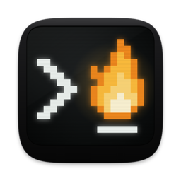

<p align="center"></p>

# Libertty

[English](README.md) | 简体中文

macOS 上的终端。VT 解析和终端状态由 [libghostty-vt](https://github.com/ghostty-org/ghostty)
负责，应用本身用 Swift 和 AppKit 写，渲染器基于 Metal 自己实现。Shell 运行在独立的守护进程
`liberttyd` 里，应用退出后程序照常运行。窗口里还能打开文档和工具：编辑器、Git 客户端、浏览器等。

## 安装

```sh
brew install --cask ziwangprincex/libertty/libertty
```

或者从[最新版本](https://github.com/ziwangprincex/Libertty/releases/latest)下载 DMG，把 Libertty
拖进"应用程序"。因为没有公证，第一次打开会被 macOS 拦下：先打开一次，再到"系统设置 ▸ 隐私与安全性"
点"仍要打开"（或者运行 `xattr -dr com.apple.quarantine /Applications/Libertty.app`）。

Libertty 会自己更新。它的 shell 里可以直接用 `libertty` 命令，Homebrew 安装时也会链接好。Git
相关功能需要 `git`（Command Line Tools 或 Homebrew 的都行），其他功能不需要。

会话里的程序申请隐私权限（摄像头、文件、完全磁盘访问）时，显示的名字是"Libertty Sessions"。要给完全
磁盘访问权限，在系统设置里添加 `/Applications/Libertty.app/Contents/MacOS/liberttyd`。

## 功能

**终端。** Metal 渲染；制表符、Powerline 和盲文字符按网格绘制；支持 kitty 图像协议和连字。
`TERM=xterm-ghostty`，自带 terminfo（`ssh` 时改发 `xterm-256color`）。zsh、bash、fish 的 shell
集成。支持 OSC 8 链接、OSC 9/777 通知、OSC 9;4 进度、OSC 52 剪贴板（默认禁止读取）、OSC 7501
程序状态。⌘-点击打开网址和 `文件:行:列`。支持 fallback 字体（`font-family` 可写多行，同 Ghostty）、
`font-thicken` 加粗，以及可选的光标拖尾（`cursor-trail`）。

**窗口。** 布局参照 Rex：标签放在左侧栏、右侧栏或顶部（`tab-bar`）；每个 pane 是一张卡片，带标题栏
（分屏、浮动、放大、关闭）；`pane-style = compact` 让 pane 铺满；`interface-style = glass` 让窗口
半透明。另有分屏、工作区、收起和浮动 pane、在窗口之间移动 pane 和标签、命令面板（⌘⇧P）、Quick
Terminal，关闭 pane、标签或窗口后可以撤销。触控板上双指张开放大 pane、捏合恢复；按住 Option 横向轻扫
显示或隐藏侧边栏。`active-border` 给当前 pane 画一圈边框。

**程序状态。** 标签上显示程序是在运行、在等你、已完成还是失败了（来自 OSC 7501，或者检测到在等密码）。
每种状态可以分别设置是否显示在标签上、是否通知、是否计入 Dock 角标、是否播放声音。动态弹窗可以按状态列出所有 pane。

**会话。** 退出、崩溃或更新时，程序在 liberttyd 里继续运行；下次启动恢复窗口、分屏、屏幕内容和回滚
历史。新版 liberttyd 会接管旧版的会话，不会中断。设了 `auto-update-restart = idle` 时，下载好的更新会在你
不用的时候自动安装。设置 ▸ liberttyd ▸ 系统权限显示 macOS 允许你的程序访问什么（完全磁盘访问、录屏、摄像头、麦克风）。

**远程主机。** 文件 ▸ Connect to Host…（`libertty +connect HOST`）让一个窗口的 pane 通过你的 `ssh`
运行在另一台机器上。主机上会装一份自己的 liberttyd（在 `~/.libertty`，不需要 root），断线后程序继续
运行。支持 macOS（Apple silicon）和 Linux（x86_64、aarch64）。

**网页访问。** `web-access = local | network | tailscale` 在浏览器里显示本机的 pane，需要带密钥的
链接才能打开。`web-access-input = false` 时只读。

**文档和工具**，可以开在新标签里，也可以放在终端旁边：

| | |
|---|---|
| 文档 | Markdown、带高亮的源码、图片、PDF、网页、`git diff` |
| 编辑器 | CodeMirror 6，支持 Vim 键位，可以当 `$EDITOR` 用（`libertty +open --wait`） |
| Git | 按文件或代码块暂存、提交、历史图、分支、推送拉取、stash、解决冲突 |
| 浏览器 | 搜索、下载；只有设了 `browser-automation = true` 才能用脚本操作 |
| 任务 | 按终端分组的进程、CPU、内存、端口 |
| 画布、看板 | Excalidraw 画图；用 Markdown 保存的看板 |
| SQLite、Notebook | 浏览和查询数据库；用你自己的 Jupyter 运行 `.ipynb` |
| 性能分析、屏幕 | 用 speedscope 查看 `sample` 的结果；通过 ScreenCaptureKit 显示屏幕或窗口 |
| 插件 | `~/.config/libertty/plugins/` 里的 JavaScript，启用前不运行 |

**编程 Agent。** `libertty +agent-setup` 给 Claude Code 和 Codex 加上 hook（给 Pi、OMP、OpenCode 装扩展），
它们的标签会显示在运行、在等你或已完成，会话按任务命名，重启后能接着之前的对话（文件 ▸ 恢复对话…，⇧⌘O）。
其他 agent 的状态从屏幕上判断。⌘J 跳到需要你处理的 pane；Git 块的 Last Turn 只显示 agent 上一轮改了什么，
可以逐块撤回或标为看过；文件 ▸ 在工作树中新建标签…（⌥⌘T）给 agent 一个独立的分支和文件夹。侧栏和 pane
标题栏显示分支和改动。截图粘贴进 pane 时粘贴的是图片文件的路径。`keep-awake = agents` 让 Mac 在 agent
工作时不睡眠。`--remove` 可以撤掉 hook。标签上显示各 agent 的官方 logo（共 30 个：Claude Code、Codex、
Gemini、CodeBuddy、Qwen Code、Kimi、Copilot、Cursor、Aider……）；关闭有 agent 在工作或在等你的 pane 时，
会直接说出是哪个 agent。

**上手。** 第一次启动时有一份简短的引导（帮助 ▸ 开始使用 Libertty）：外观、权限、agent 设置、导入 Ghostty
设置、几个常用快捷键。`libertty +migrate-prompt`（或帮助 ▸ 用 Agent 迁移快捷键…）生成一段 prompt，让 agent
把你在 Ghostty、iTerm2 或 tmux 里的快捷键搬过来。

**语言。** 英文，或在 macOS 使用简体中文时显示简体中文（`language = auto | en | zh-Hans`）。

## 配置

配置文件是 `~/.config/libertty/config`，格式和 Ghostty 相同。Libertty ▸ Settings…（⌘,）可以图形化
修改，每改一项只改文件里的一行；也可以直接编辑文件，保存后生效。主题可以用 Ghostty 主题文件，可以按名字
使用已安装的 Ghostty 或 Rex 自带的主题（`theme = light:Merino Light,dark:Merino Dark`），也可以在
Libertty ▸ Theme Editor… 里自己做。

```sh
libertty +set theme="Tokyo Night" font-size=14
libertty +show-config --changes      # --default, --docs
libertty +validate-config
libertty +import-ghostty --dry-run
libertty +list-themes                # +list-fonts, +list-keybinds, +list-actions
```

## 命令行

`libertty +help` 列出所有命令。常用的：

```sh
libertty +new-window --cwd ~/src -e htop
libertty +open [--split] [--wait] FILE[:LINE]
libertty +list-sessions
libertty +send ID 'make test\n' ; libertty +send-key ID ctrl+c
libertty +capture ID [--scrollback] [--ansi | --html]
libertty +wait ID --until exit|prompt|idle=MS
libertty +split [ID] [--down] [-e COMMAND]
libertty +prompt ID 'review src/auth'      # 问另一个 agent，打印它的回答
libertty +events --for waiting --once      # 等到有程序在等你
libertty +new-session --worktree fix-login -e claude
libertty +history ; libertty +resume ID   # agent 以前的对话
libertty +diff --turn                      # agent 上一轮改了什么
libertty +migrate-prompt --from tmux       # 生成让 agent 迁移快捷键的 prompt
```

会话相关的命令都支持 `--host HOST`。`$LIBERTTY_SESSION` 是当前 pane 的会话 ID。

## 构建

需要 Swift 6（Command Line Tools 即可）和 Zig 0.17（`brew install zig`）。Node.js 只在重新构建内置
网页时需要，仓库里已经有构建好的版本。

```sh
git submodule update --init vendor/ghostty
scripts/build-libghostty-vt.sh       # 第一次，以及更新 vendor/ghostty 之后
scripts/bundle.sh                    # 生成 build/Libertty.app；加 release 是优化版本
open build/Libertty.app
```

手动运行的构建默认会连到你正在用的 liberttyd，怎么隔开见 [docs/DEVELOPMENT.md](docs/DEVELOPMENT.md)。

## 测试

| 命令 | 内容 |
|---|---|
| `swift test` | 单元测试：配置、颜色、分屏树、通信协议（不到一秒） |
| `zsh tests/run.sh` | 无头测试：按像素比对渲染、会话、命令行，以及在屏幕外驱动应用的 UI 脚本（约 4 分钟） |
| `tests/screen-check.sh` | 在真实屏幕上运行构建好的应用，把各种布局和窗口拼成一张截图并做检查（半分钟，会占用屏幕） |
| `tests/linux.sh` | 在 Docker 里测试 Linux 上的 liberttyd |
| `tests/update-test.sh` | 离线测试更新流程 |

每次推送，CI 都会跑单元测试和无头测试，并编译 Linux 版 liberttyd。和其他终端的性能对比在
`bench/RESULTS.md`。

## 发布

`scripts/release.sh VERSION` 根据 `docs/CHANGELOG.md` 测试、构建、签名并准备好发布文件，再在真实屏幕上
检查一遍；`--publish` 上传到 GitHub 和 Homebrew tap。具体步骤见 [docs/DEVELOPMENT.md](docs/DEVELOPMENT.md)。

## 目录

| 路径 | 内容 |
|---|---|
| `Sources/LiberttyApp/` | 应用 |
| `Sources/LiberttyCore/`、`Sources/liberttyd/` | 应用和守护进程共用的部分；守护进程 |
| `blocks/`、`frontend/` | 工具的网页及其源码 |
| `vendor/` | Ghostty、CodeMirror、Geist 字体 |
| `Resources/` | Shell 集成、terminfo、Linux 版 liberttyd |
| `tests/`、`bench/`、`scripts/`、`docs/` | 测试、性能测试、构建和发布脚本、文档 |

## 第三方组件

libghostty-vt（MIT）、带 Nerd Fonts 图标的 JetBrains Mono（OFL-1.1）、Geist（OFL-1.1）、CodeMirror 6
（MIT）、Excalidraw 和 React（MIT）、speedscope（MIT）。完整声明见 `Resources/THIRD-PARTY-NOTICES.txt`。标签上各编程 agent 的 logo（`Resources/logos`）是各自厂商的商标，只用来标明面板里运行的是哪个程序；每个 logo 的来源也列在该文件里。
